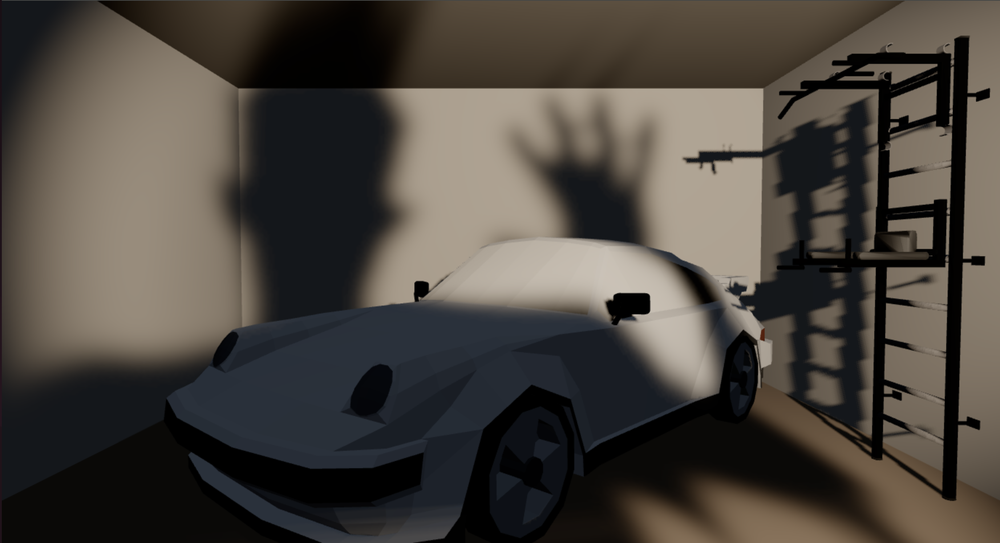

# 3d-bg

A 3D room on your screen where your webcam silhouette casts a shadow. The idea and what
could come next are in [PLAN.md](PLAN.md).



## Run

```bash
python3 -m http.server --bind 127.0.0.1
```

Open <http://localhost:8000> in Chrome, click a step, and allow the camera.

Why a server: browsers only allow the camera on `localhost` or HTTPS, and won't load the
libraries into a page opened as a plain file. `--bind 127.0.0.1` means only this laptop can
open it.

## Steps

Each file can be read top to bottom. Each one builds on the one before.

| File | What it does | Library |
|---|---|---|
| `1-camera.html` | Shows the webcam, mirrored | none |
| `2-silhouette.html` | Finds you in the picture and draws a black shape where you are | MediaPipe |
| `3-room.html` | A room, a cube and a lamp | three.js |
| `4-shadow.html` | Steps 2 and 3 together: your silhouette blocks the lamp, so you cast a shadow into the room | both |
| `5-garage.html` | Step 4 with 3D models in the room instead of the cube | both |
| `6-hand.html` | Finds your hand: draws its 21 points and names the gesture | MediaPipe |
| `7-spin.html` | Step 5, plus grab the car with your fist and spin it | both |

The hand tracking for steps 6 and 7 lives in its own file, `hand.js`, so the pages only
decide what a hand *does*. The rest of each page still reads top to bottom on its own.

The libraries load straight from the internet, so you need to be online. Camera frames
never leave the page.

## As your wallpaper

```bash
./wallpaper.sh                 # runs 7-spin.html
./wallpaper.sh 4-shadow.html   # or any other step
```

It opens the page in its own fullscreen Chrome, then tells GNOME the window is part of the
desktop: below every window, on every workspace, not in Alt+Tab, and behind your desktop
icons. Ctrl+C in the terminal stops it. GNOME on X11 only. While it runs, the camera is on
and the battery drains faster.

## Adding things to the room

1. Download a model as `.glb` (one file, everything packed inside). On Sketchfab pick
   *Download 3D Model → GLB*.
2. Put it in `models/`.
3. Add a line to the `things` list near the top of `5-garage.html` (or `7-spin.html`):
   ```js
   { file: 'models/chair.glb', size: 0.9, position: [1.8, 0, -3.5], turn: -20 },
   ```
   `size` is its longest side in metres, `position` is where it stands (0 up = on the
   floor), `turn` is in degrees. In step 7, add `spins: true` to make it spinnable.

If a file is missing, the room still opens and the Console says which one it skipped.
Some models are compressed with Draco and need an extra loader; if one won't load, try a
different download or ask.

If a page stays black, open DevTools (F12) and look at the Console for the error.

## Licences

- **This project's code:** MIT, see [LICENSE](LICENSE).
- **Libraries** (loaded from a CDN, not stored here): [three.js](https://threejs.org) is MIT;
  [MediaPipe](https://ai.google.dev/edge/mediapipe) is Apache 2.0. The segmentation model
  is Google's, see its model card for terms.
- **3D models** in `models/`, each licensed under Creative Commons Attribution, which
  means the authors must be credited:
  - "porsche 911 930 low poly" (https://skfb.ly/oIvY9) by Panderlon is licensed under
    Creative Commons Attribution (http://creativecommons.org/licenses/by/4.0/).
  - "WALL BAR SET WORKOUT STATION WINNER BLACK 4" (https://skfb.ly/6FFp7) by BenchK is
    licensed under Creative Commons Attribution (http://creativecommons.org/licenses/by/4.0/).

When you add a model, add its credit here.
